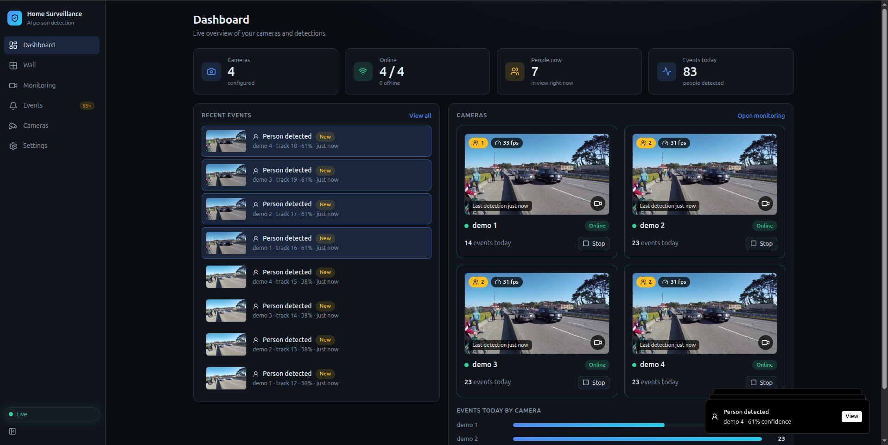
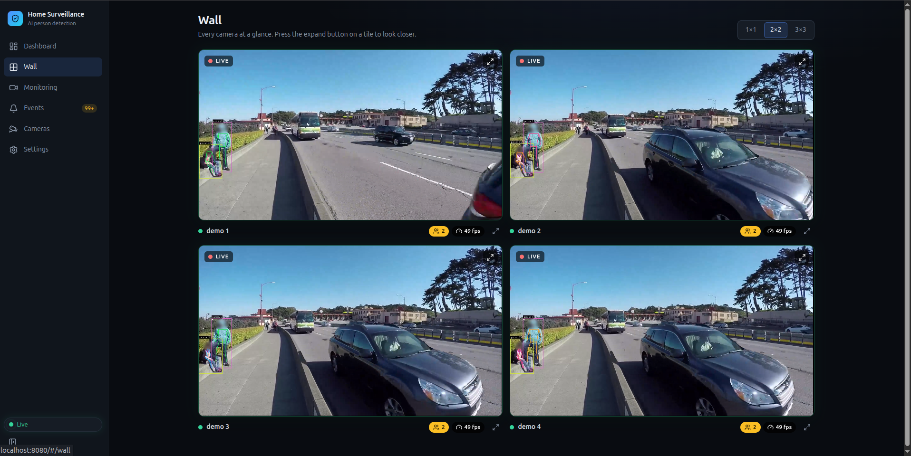
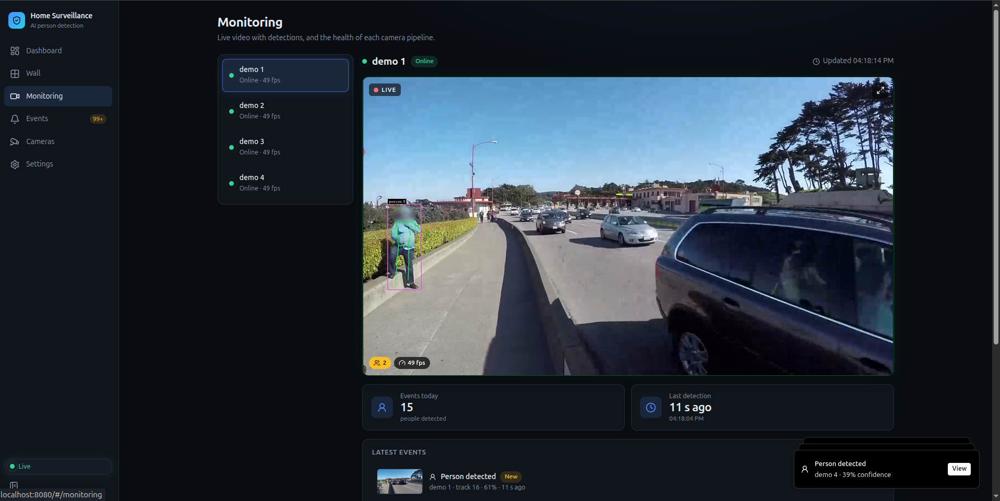
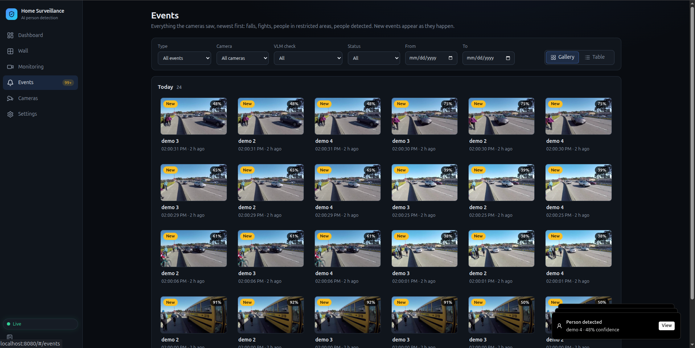
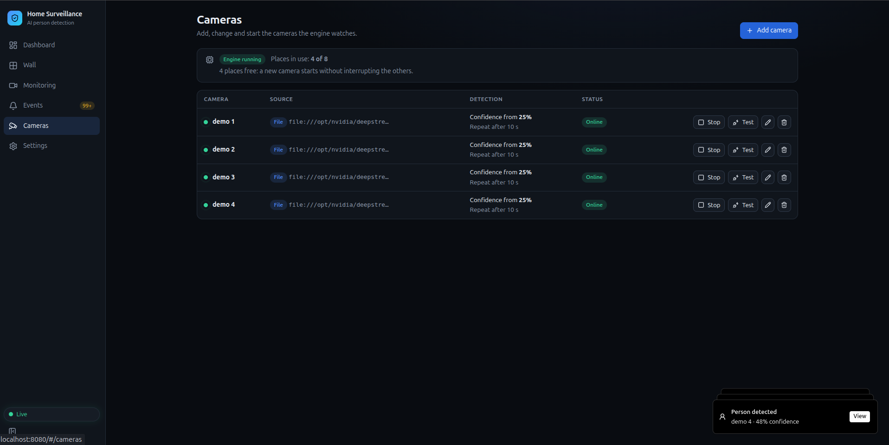
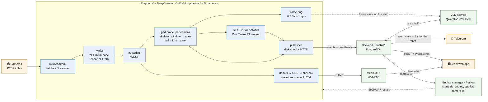

# AI-Based Home Surveillance

**Fall detection on several cameras at once, on one GPU, running locally.**
A person alone at home falls and cannot get up. This system reads body posture from a skeleton (no faces, nobody is identified),
recognises the fall within a second or two, has a local vision-language model double-check it, and sends a Telegram alert.

**[▶ Live demo](https://ngocluong0101.github.io/AI-Based-Home-Surveillance/)** — the real web app in your browser with made-up
cameras, no install. Open **Monitoring → Living room**: about every 70 s a person walks in and falls, a FALL alert arrives.
*(The demo is drawn by code; the numbers below are not from it.)*

SCREENSHOTS: 
<p align="center">
  
  
  
  
  
</p>


## Built with

| | |
|---|---|
| **Video pipeline** | C, NVIDIA DeepStream 7.1 (`nvstreammux`, `nvinfer`, `nvtracker`), GStreamer, RTSP in / H.264 + WebRTC out |
| **Models** | YOLOv8n-pose (TensorRT FP16), a small ST-GCN skeleton network (C++ TensorRT), Qwen3-VL-2B as a local second opinion |
| **Backend** | Python, FastAPI, PostgreSQL, WebSocket, Telegram |
| **Web app** | React, TypeScript, Vite |
| **Ops** | Docker Compose (7 containers), fail-open design, spool-to-disk delivery, benchmarks and soak tests |
| **Evaluation** | `eval/`: metric definitions fixed before measuring, results as files, tests on datasets the system was not built on |

## How it works



- **One process, N cameras.** `nvstreammux` batches all cameras into one GPU pipeline: 30 fps on each of 12 cameras on a laptop RTX 4060
  (8 with the VLM running). Eight separate processes for eight cameras (detection only) needed about 4× the RAM and 3× the CPU.
- **Rules first, network second.** Hand-written fall rules are the baseline and the fallback; a small skeleton network beats them
  and runs beside them. Rules exist twice (Python = specification, C = engine) and run the same test vectors.
- **Fail-open everywhere.** No model file, a slow or dead VLM, a missing frame: the alert still goes out. The VLM only adds a note.
- **Nothing is lost.** If the backend is down, events go to a disk spool and are delivered later (idempotent by event id).

## Results

Every number is a file in [`eval/results/`](eval/results/); definitions in [`eval/DEFINITIONS.md`](eval/DEFINITIONS.md).

| | Result | Condition (read this before quoting it) |
|---|---|---|
| **Falls caught** | **28 of 30** (rules: 14 of 30) | UR Fall dataset, one room, cross-validated. On people and rooms it had never seen (GMDCSA-24): **68–75%** |
| **False alarms** | **1 of 40** daily-activity sequences | UR Fall. On unseen people: ~4% of clips (14% before I added that data to training). **Per camera-hour: not measured**, I have no hours of real household footage |
| **Throughput** | **30 fps on every camera at 1, 4, 8, 12 cameras** | 1080p H.264, fake RTSP cameras, RTX 4060 8 GB. With the VLM: 8 cameras |
| **Latency** | fall → alert **0.18 s** after the network decides (~4.5 s with the VLM check) | UR Fall clips replayed in real time through the real engine |

More: [all measurements with caveats](docs/REFERENCE.md#results), [three write-ups of what went wrong](docs/REFERENCE.md#write-ups).

## Limitations (what this is not)

- **Borrowed, acted data.** Trained and tuned on UR Fall and GMDCSA-24 (volunteers acting falls). **No footage of a real home yet**,
  so these numbers say little about one.
- **Fight detection does not work.** On acted fights (AIRTLab) the rule reports 88% of violent clips and 92% of hugs and high fives.
  Unit tests pass; the rule is not a result.
- **The VLM is not a gatekeeper.** On unseen people it would have silenced 16% of real falls, so it only adds a note to the alert.
- **Pose misses small or hidden people** (recall 0.02 for people 100–200 px tall).
- **Not tried** on a physical IP camera, for days (longest run: 1 h), or on Jetson. **No login**: for one machine in a trusted LAN.

## Quick start

Needs Docker with the NVIDIA Container Toolkit and an NVIDIA GPU (8 GB is enough for 8 cameras plus the VLM).

```bash
git clone <this repo> && cd AI-Based-Home-Surveillance
pip install -r requirements.txt
python engine/tools/export_yolov8_pose_onnx.py       # skeleton detector -> engine/models/ (ONNX files are not in the repo)
cp .env.example .env                                 # set POSTGRES_PASSWORD, INTERNAL_TOKEN, PUBLIC_HOST (Telegram optional)
docker compose --env-file .env -f deploy/compose.yml up -d --build
```

Open `http://localhost:8080` → **Cameras → Add camera** → **Test connection** → **Save** → **Start**.
No camera? Put an MP4 in `data/videos/` and use `file:///videos/<name>.mp4`.
The first start builds TensorRT engines (about 3 minutes) and the first VLM start downloads a 4.3 GB model.
The fall network is optional: without it every camera uses the rules ([how to train it](docs/REFERENCE.md#quick-start-docker)).

## Where to look

| | |
|---|---|
| [`docs/REFERENCE.md`](docs/REFERENCE.md) | full documentation: set-up, every setting, engine options, API, tests, troubleshooting |
| [`engine/`](engine/) | the C pipeline (`src/`), pure-C core with tests (`src/core/`), YOLOv8-pose parser, TensorRT ST-GCN |
| [`eval/`](eval/) | how every number was measured, and how to measure it again |
| [`backend/`](backend/), [`frontend/`](frontend/), [`vlm_service/`](vlm_service/), [`deploy/`](deploy/) | the rest of the system |
| [`docs/posts/`](docs/posts/) | three short articles: a detector that found 10% fewer people, a fall rule that scored 0 then 5 of 5, a VLM that said yes to everyone |
